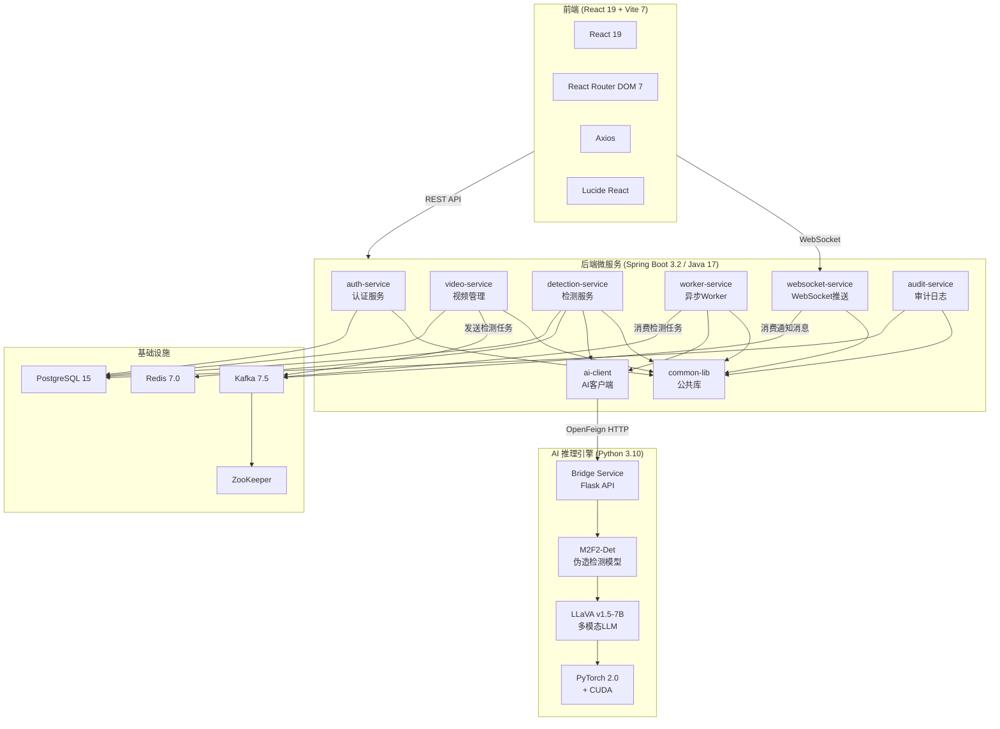

# 开源代码与组件使用情况说明

> **项目名称**：视频深度伪造检测系统（Video Detection System）  
> **编写日期**：2026 年 4 月 22 日  
> **文档版本**：v1.0

---

## 一、项目概述

本系统是一个面向视频/图像深度伪造检测（Deepfake Detection）的全栈应用，由三大子系统组成：

| 子系统 | 技术栈 | 说明 |
|--------|--------|------|
| **后端微服务**（Video-Detection-System） | Java 17 / Spring Boot 3.2 | 用户认证、视频管理、检测调度、审计日志等 |
| **前端控制台**（frontend） | React 19 / Vite 7 | 取证分析可视化界面 |
| **AI 推理引擎**（M2F2_Det） | Python 3.10 / PyTorch 2.0 | 基于 M2F2-Det 多模态大模型的伪造检测 |

---

## 二、开源代码引用说明

### 2.1 M2F2_Det — 核心 AI 检测模型

| 项目 | 信息 |
|------|------|
| **项目名称** | M2F2_Det (Multi-Modal Interpretable Forged Face Detector) |
| **论文** | *Rethinking Vision-Language Model in Face Forensics: Multi-Modal Interpretable Forged Face Detector* (CVPR 2025 Oral) |
| **论文地址** | [arXiv:2503.20188](https://arxiv.org/abs/2503.20188) |
| **代码仓库** | [GitHub - CHELSEA234/M2F2_Det](https://github.com/CHELSEA234/M2F2_Det) |
| **模型权重** | [Hugging Face - llava-v1.5-7b-M2F2-Det](https://huggingface.co/CHELSEA234/llava-v1.5-7b-M2F2-Det) |
| **许可证** | MIT License |
| **作者** | Xiao Guo, Xiufeng Song, Yue Zhang, Xiaohong Liu, Xiaoming Liu |
| **在本项目中的用途** | 提供深度伪造二分类检测（FAKE/REAL）以及 LLaVA 大语言模型驱动的自然语言解释分析 |

**引用格式（BibTeX）**：
```bibtex
@inproceedings{M2F2_Det_xiao,
  author    = {Xiao Guo and Xiufeng Song and Yue Zhang and Xiaohong Liu and Xiaoming Liu},
  title     = {Rethinking Vision-Language Model in Face Forensics: Multi-Modal Interpretable Forged Face Detector},
  booktitle = {Computer Vision and Pattern Recognition},
  year      = {2025},
}
```

### 2.2 LLaVA — 多模态大语言模型基座

| 项目 | 信息 |
|------|------|
| **项目名称** | LLaVA (Large Language and Visual Assistant) |
| **代码仓库** | [GitHub - haotian-liu/LLaVA](https://github.com/haotian-liu/LLaVA) |
| **使用版本** | LLaVA v1.5-7B |
| **许可证** | Apache License 2.0 |
| **在本项目中的用途** | 作为 M2F2_Det 的底层多模态模型基座，提供视觉-语言对齐能力和文本生成推理 |

---

## 三、后端微服务组件清单（Java / Spring Boot）

### 3.1 框架与核心依赖

| 组件 | GroupId | ArtifactId | 版本 | 许可证 | 用途 |
|------|---------|------------|------|--------|------|
| Spring Boot | org.springframework.boot | spring-boot-starter-parent | 3.2.0 | Apache 2.0 | 微服务应用框架 |
| Spring Cloud | org.springframework.cloud | spring-cloud-dependencies | 2025.0.0 | Apache 2.0 | 微服务治理 BOM |
| Spring Boot Web | org.springframework.boot | spring-boot-starter-web | 3.2.0 | Apache 2.0 | RESTful API 服务 |
| Spring Security | org.springframework.boot | spring-boot-starter-security | 3.2.0 | Apache 2.0 | 认证与授权框架 |
| Spring Data JPA | org.springframework.boot | spring-boot-starter-data-jpa | 3.2.0 | Apache 2.0 | ORM 数据持久化 |
| Spring Data Redis | org.springframework.boot | spring-boot-starter-data-redis | 3.2.0 | Apache 2.0 | 缓存与会话管理 |
| Spring WebSocket | org.springframework.boot | spring-boot-starter-websocket | 3.2.0 | Apache 2.0 | 实时消息推送 |
| Spring AOP | org.springframework.boot | spring-boot-starter-aop | 3.2.0 | Apache 2.0 | 面向切面编程（审计日志） |
| Spring Kafka | org.springframework.kafka | spring-kafka | 3.1.x | Apache 2.0 | 异步消息队列通信 |
| Spring Retry | org.springframework.retry | spring-retry | 2.0.x | Apache 2.0 | AI 调用失败重试机制 |
| Spring Validation | org.springframework.boot | spring-boot-starter-validation | 3.2.0 | Apache 2.0 | 请求参数校验 |
| Spring Cloud OpenFeign | org.springframework.cloud | spring-cloud-starter-openfeign | 4.1.x | Apache 2.0 | 声明式 HTTP 客户端（调用 AI 服务） |

### 3.2 第三方库

| 组件 | GroupId | ArtifactId | 版本 | 许可证 | 用途 |
|------|---------|------------|------|--------|------|
| PostgreSQL Driver | org.postgresql | postgresql | 42.7.x | BSD-2-Clause | 关系型数据库驱动 |
| JJWT (API) | io.jsonwebtoken | jjwt-api | 0.11.5 | Apache 2.0 | JWT 令牌生成与验证 |
| JJWT (Impl) | io.jsonwebtoken | jjwt-impl | 0.11.5 | Apache 2.0 | JWT 运行时实现 |
| JJWT (Jackson) | io.jsonwebtoken | jjwt-jackson | 0.11.5 | Apache 2.0 | JWT JSON 序列化 |
| Lombok | org.projectlombok | lombok | 1.18.34 | MIT | 样板代码自动生成 |
| MapStruct | org.mapstruct | mapstruct | 1.6.3 | Apache 2.0 | 对象映射（DTO ↔ Entity） |
| Jackson Databind | com.fasterxml.jackson.core | jackson-databind | 2.16.x | Apache 2.0 | JSON 序列化/反序列化 |
| Jackson JSR310 | com.fasterxml.jackson.datatype | jackson-datatype-jsr310 | 2.16.x | Apache 2.0 | Java 8 时间类型序列化 |
| Commons Lang3 | org.apache.commons | commons-lang3 | 3.14.x | Apache 2.0 | 字符串/对象通用工具 |
| Commons Codec | commons-codec | commons-codec | 1.16.x | Apache 2.0 | 编码/解码工具（SHA-256 哈希等） |
| Commons IO | commons-io | commons-io | 2.13.0 | Apache 2.0 | 文件 I/O 工具类 |
| AspectJ Weaver | org.aspectj | aspectjweaver | 1.9.x | EPL 1.0 | AOP 织入（审计切面） |
| Jakarta Servlet API | jakarta.servlet | jakarta.servlet-api | 6.0.x | EPL 2.0 / GPL 2.0 | Servlet 规范接口 |

### 3.3 后端模块与职责

| 模块 | 说明 | 核心依赖 |
|------|------|----------|
| **common-lib** | 共享实体、DTO、枚举、工具类 | JPA, Security, Kafka, Jackson, MapStruct, JWT |
| **auth-service** | 用户注册/登录、JWT 认证 | Web, Security, JPA, Kafka, JWT, Validation |
| **video-service** | 视频上传、存储管理、检测任务创建 | Web, JPA, Security, Kafka, Validation |
| **detection-service** | 检测结果查询与报告生成 | Web, JPA, Security, Redis, Kafka, AI Client |
| **worker-service** | 异步检测 Worker（消费 Kafka 任务） | Web, JPA, Kafka, AI Client |
| **websocket-service** | WebSocket 实时通知推送 | Web, WebSocket, Kafka, Redis |
| **audit-service** | 操作审计日志记录与查询 | Web, JPA, AOP, Security, Kafka, AspectJ |
| **ai-client** | AI 推理服务 HTTP 客户端封装 | OpenFeign, Spring Retry, AOP, Jackson |

---

## 四、前端组件清单（React / Vite）

### 4.1 运行时依赖

| 组件 | 版本 | 许可证 | 用途 |
|------|------|--------|------|
| React | ^19.2.0 | MIT | UI 组件化框架 |
| React DOM | ^19.2.0 | MIT | React DOM 渲染引擎 |
| React Router DOM | ^7.11.0 | MIT | 客户端路由管理 |
| Axios | ^1.13.2 | MIT | HTTP 请求库（与后端 API 通信） |
| Lucide React | ^0.562.0 | ISC | 图标组件库 |

### 4.2 开发依赖

| 组件 | 版本 | 许可证 | 用途 |
|------|------|--------|------|
| Vite | ^7.2.4 | MIT | 现代前端构建工具 |
| @vitejs/plugin-react | ^5.1.1 | MIT | Vite React 插件 |
| ESLint | ^9.39.1 | MIT | 代码质量检查工具 |
| eslint-plugin-react-hooks | ^7.0.1 | MIT | React Hooks 规则检查 |
| eslint-plugin-react-refresh | ^0.4.24 | MIT | React Fast Refresh 检查 |
| @types/react | ^19.2.5 | MIT | React TypeScript 类型定义 |
| @types/react-dom | ^19.2.3 | MIT | React DOM TypeScript 类型定义 |

---

## 五、AI 推理引擎组件清单（Python）

### 5.1 深度学习框架

| 组件 | 版本 | 许可证 | 用途 |
|------|------|--------|------|
| PyTorch | 2.0.1 | BSD-3-Clause | 深度学习核心框架 |
| TorchVision | 0.16.2 | BSD-3-Clause | 图像预处理与预训练模型 |
| CUDA Toolkit | 11.7 / 12.1 | NVIDIA EULA | GPU 加速计算 |
| Flash Attention 2 | 2.5.7 | BSD-3-Clause | 高效注意力计算加速 |
| xFormers | 0.0.23.post1 | BSD-3-Clause | 内存高效 Transformer 组件 |
| DeepSpeed | 0.12.6 | Apache 2.0 | 分布式训练优化（训练阶段） |

### 5.2 大语言模型与 NLP

| 组件 | 版本 | 许可证 | 用途 |
|------|------|--------|------|
| Transformers (Hugging Face) | 4.37.0 | Apache 2.0 | 预训练模型加载与推理 |
| Tokenizers | 0.15.1 | Apache 2.0 | 高性能分词器 |
| SentencePiece | 0.1.99 | Apache 2.0 | 子词分词（LLaMA Tokenizer） |
| Accelerate | 0.21.0 | Apache 2.0 | 混合精度与多 GPU 加速 |
| PEFT | 0.10.0 | Apache 2.0 | 参数高效微调（LoRA） |
| BitsAndBytes | 0.43.1 | MIT | 4-bit / 8-bit 量化推理 |
| SafeTensors | 0.4.3 | Apache 2.0 | 安全模型权重加载 |

### 5.3 计算机视觉

| 组件 | 版本 | 许可证 | 用途 |
|------|------|--------|------|
| OpenCV-Python | 4.5.5.62 | Apache 2.0 | 视频抽帧与图像处理 |
| Pillow (PIL) | 11.1.0 | HPND | 图像加载与格式转换 |
| timm | 0.4.12 | Apache 2.0 | 预训练视觉模型库（EfficientNet 等） |
| EfficientNet-PyTorch | 0.7.1 | Apache 2.0 | EfficientNet 模型实现 |
| scikit-image | 0.25.0 | BSD-3-Clause | 图像科学计算 |
| Segment Anything (SAM) | 1.0 | Apache 2.0 | Meta 图像分割模型 |

### 5.4 Web 服务与 API

| 组件 | 版本 | 许可证 | 用途 |
|------|------|--------|------|
| Flask | — | BSD-3-Clause | AI Bridge HTTP API 服务 |
| FastAPI | 0.110.1 | MIT | 异步 REST API 框架 |
| Uvicorn | 0.29.0 | BSD-3-Clause | ASGI 服务器 |
| Gradio | 4.16.0 | Apache 2.0 | 模型演示 Web UI |
| HTTPX | 0.24.0 | BSD-3-Clause | 异步 HTTP 客户端 |

### 5.5 数据科学与工具

| 组件 | 版本 | 许可证 | 用途 |
|------|------|--------|------|
| NumPy | 1.26.4 | BSD-3-Clause | 数值计算基础库 |
| Pandas | 2.2.2 | BSD-3-Clause | 数据分析与处理 |
| scikit-learn | 1.2.2 | BSD-3-Clause | 机器学习评估指标 |
| SciPy | 1.15.3 | BSD-3-Clause | 科学计算 |
| Matplotlib | 3.8.4 | PSF | 数据可视化 |
| NetworkX | 3.4.2 | BSD-3-Clause | 图（Graph）数据结构与分析 |
| H5py | 3.11.0 | BSD-3-Clause | HDF5 数据集读取 |
| TensorBoardX | 2.6.2.2 | MIT | 训练日志可视化 |
| WandB | 0.16.6 | MIT | 实验跟踪与可视化 |

### 5.6 推理优化

| 组件 | 版本 | 许可证 | 用途 |
|------|------|--------|------|
| vLLM | 0.4.0.post1 | Apache 2.0 | 高吞吐 LLM 推理引擎 |
| SGLang | 0.1.14 | Apache 2.0 | 结构化生成语言引擎 |
| Ray | 2.10.0 | Apache 2.0 | 分布式计算框架 |
| Triton | 2.0.0 | MIT | GPU 内核编译器 |

---

## 六、基础设施与中间件

| 组件 | 版本 / 镜像 | 许可证 | 用途 |
|------|-------------|--------|------|
| PostgreSQL | 15-alpine | PostgreSQL License (类 MIT) | 关系型数据库（用户、视频、检测记录） |
| Apache Kafka | confluentinc/cp-kafka:7.5.0 | Apache 2.0（Confluent Community License） | 异步消息队列（检测任务调度） |
| Apache ZooKeeper | confluentinc/cp-zookeeper:7.5.0 | Apache 2.0 | Kafka 集群协调 |
| Redis | 7.0-alpine | BSD-3-Clause | 缓存、会话存储、WebSocket 状态 |
| Docker | — | Apache 2.0 | 容器化部署 |
| Docker Compose | v3.8 | Apache 2.0 | 多容器编排 |

---

## 七、构建工具

| 工具 | 版本 | 用途 |
|------|------|------|
| Apache Maven | 3.9.x | Java 后端多模块项目构建 |
| Maven Compiler Plugin | 3.11.0 | Java 编译（含 Lombok / MapStruct 注解处理） |
| Spring Boot Maven Plugin | 3.2.0 | 可执行 JAR 打包 |
| npm / Node.js | Node 20+ | 前端依赖管理与构建 |
| Vite | 7.2.4 | 前端开发服务器与生产构建 |
| Conda | — | Python 环境管理 |
| pip | 24.0 | Python 包管理 |
| setuptools | 68.2.2 | Python 包构建 |

---

## 八、许可证合规性汇总

本项目涉及的开源许可证类型及合规要求如下：

| 许可证类型 | 涉及组件 | 核心义务 |
|-----------|----------|----------|
| **MIT** | 本项目代码、M2F2_Det、Lombok、React、Vite 等 | 保留版权声明和许可声明 |
| **Apache 2.0** | Spring 全家桶、Transformers、Kafka 等 | 保留版权声明、NOTICE 文件、声明修改部分 |
| **BSD-2/3-Clause** | PyTorch、PostgreSQL Driver、NumPy 等 | 保留版权声明（不可用原作者做背书） |
| **EPL 1.0/2.0** | AspectJ、Jakarta Servlet | 修改后的文件须声明变更（与 GPL 2.0 双许可可选） |
| **NVIDIA EULA** | CUDA 运行时库 | 仅限 NVIDIA GPU 使用，不可再分发运行时 |
| **PostgreSQL License** | PostgreSQL 数据库 | 类 MIT，保留版权声明即可 |
| **HPND** | Pillow | 保留版权声明 |

> **合规建议**：
> 1. 在项目发布时保留所有第三方组件的 LICENSE 和 NOTICE 文件。
> 2. M2F2_Det 模型如用于学术发表，请引用原论文（见第 2.1 节）。
> 3. NVIDIA CUDA 运行时库不可单独再分发，需确保用户自行安装 CUDA 驱动。

---

## 九、组件依赖关系图



---

## 十、版本兼容性说明

| 运行环境 | 最低要求 | 推荐版本 |
|----------|----------|----------|
| JDK | 17 | 17 LTS |
| Node.js | 18+ | 20 LTS |
| Python | 3.10 | 3.10.14 |
| CUDA | 11.7 | 12.1 |
| GPU 显存 | 8 GB（4-bit 量化） | 16 GB+ |
| Docker | 20.10+ | 24.x |
| 操作系统 | Linux / Windows | Ubuntu 22.04 / Windows 11 |

---

*本文档基于项目实际依赖配置文件（`pom.xml`、`package.json`、`environment.yml`、`pyproject.toml`、`docker-compose-infra.yml`）整理生成，如有版本更新请同步修改。*
